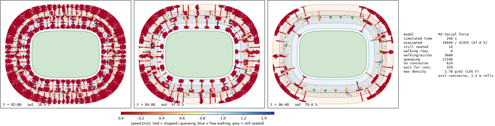
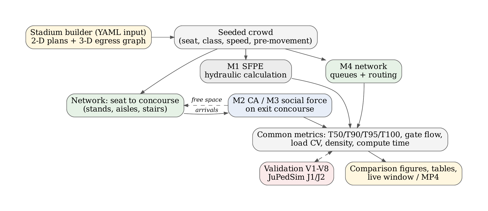
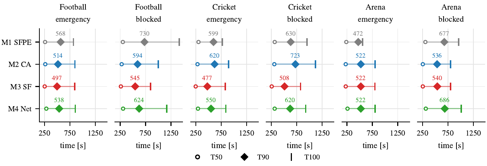
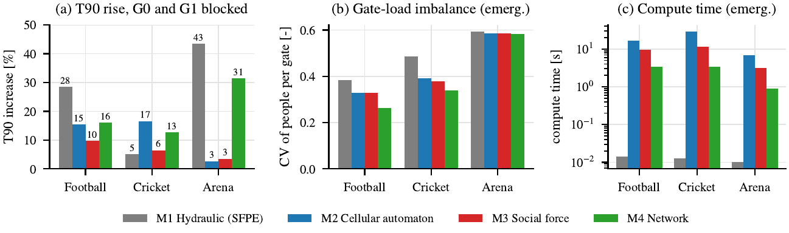
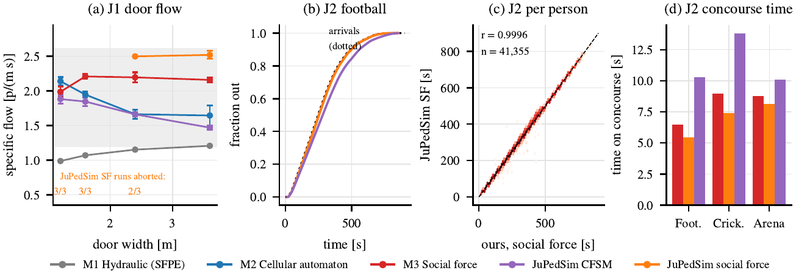

# Stadium Evacuation Models

A Python framework for comparing four crowd-flow and emergency-evacuation models on the same stadiums, the same crowds and the same scenarios. It answers one question: if only the model changes, how much does the predicted evacuation time change, and where do the models disagree most?



Each dot is a spectator, coloured by speed (red is stopped or queueing, blue is walking freely).

## Video walkthrough

[](https://youtu.be/IIM1ITQazN8)

Click the thumbnail to watch the walkthrough: the four models, live simulation runs, results, and the JuPedSim validation.

## What it does

- Builds three parametric stadiums from YAML files: a football bowl (41,355 people at 95 % occupancy, 20 gates), a cricket oval (40,603 people, 20 gates) and an indoor arena (7,771 people, 8 doors, sunken bowl).
- Generates a seeded crowd with seats, mobility classes (adult, child, elderly, mobility impaired), walking speeds, body sizes and pre-movement delays.
- Runs four models on identical crowds:

| Model | Key | Type | Idea |
|---|---|---|---|
| M1 Hydraulic (SFPE) | `sfpe` | macroscopic, analytic | Everyone takes the nearest exit. Each route is limited by its controlling component, served first-come-first-served at the SFPE capacity. |
| M2 Cellular automaton | `ca` | microscopic, discrete | Floor-field model on 0.4 m cells with density-dependent speed, friction and herding. |
| M3 Social force | `sf` | microscopic, continuous | Helbing-type forces with body contact, friction and a herding parameter. Numba-accelerated. |
| M4 Queueing network | `network` | mesoscopic | Element-by-element movement with capacities, storage, spill-back and congestion-aware route choice. |

- M2 and M3 are hybrids. The network carries people from seats through aisles, vomitories and stairs, and the detailed model runs on the exit concourse. People wait upstream until the concourse has room, so congestion backs up into the stands.
- Height is handled without a 3-D simulation: each tier and concourse is a level, and stepped aisles, stairs and ramps are network elements with 3-D length, width, vertical drop and type.
- Scores every run with the same metrics: T50, T90, T95, T100, mean gate flow, exit-load balance (CV), peak density, Fruin level of service and compute time.
- Cross-checks the models against [JuPedSim](https://www.jupedsim.org) and PedPy.



## Setup

Tested on Ubuntu with Python 3.10, 3.12 and 3.13.

```bash
sudo apt update && sudo apt install -y python3-venv python3-pip python3-tk ffmpeg
git clone <this repository>
cd stadium-evac
python3 -m venv .venv
source .venv/bin/activate
pip install --upgrade pip
pip install -r requirements.txt
```

The first social-force run compiles its Numba kernels (10 to 30 seconds once). `python3-tk` is needed for the live window and `ffmpeg` for recorded videos.

## Verify the install

```bash
python -m pytest -q          # unit tests
python run.py check-phase1   # stadiums, crowds, metrics
python run.py check-phase2   # all models on all stadiums (3 to 5 min)
python run.py validate       # validation suite (1 to 2 min)
```

Each command exits with status 0 only if every check passes.

## Usage

```bash
python run.py list           # available stadiums, scenarios and models

# one model, one scenario
python run.py simulate --stadium football_bowl --scenario emergency --model sf --seed 1

# all four models on identical crowds, three random crowds each
python run.py compare --stadium football_bowl --scenario emergency --seeds 3

# a subset of models, a blocked-exit scenario, an override of a model parameter
python run.py compare --stadium indoor_arena --scenario blocked_exit --models sfpe,network --seeds 5
python run.py compare --stadium football_bowl --scenario emergency --models sf --seeds 3 --set sf.tau=0.8 --out results/sensitivity/sf_tau_0.8
```

### Watch a run live

```bash
python run.py live --stadium football_bowl --scenario emergency --models all --seed 1 --record
bash scripts/live_three_stadiums.sh
```

The window draws the run while it is computed (SPACE pauses, Q closes). Afterwards, CSVs and figures are written to `results/live/<stadium>/<scenario>/`, with the MP4 next to them when `--record` is used.

### Replay videos

```bash
python run.py animate --stadium football_bowl --scenario emergency --models network,ca,sf --seed 1
python run.py animate --stadium indoor_arena --scenario blocked_exit --crowd-fraction 0.2 --frame-dt 3
```

### JuPedSim cross-check

```bash
pip install -r requirements-jupedsim.txt
python run.py jupedsim-verify --live
```

This runs a single-door bottleneck test (180 people, door widths 1.2 to 3.6 m) and replays the concourse of each stadium with the same arrivals.

## Scenarios

| Scenario | Description |
|---|---|
| `normal_egress` | End-of-match exit: normal speeds, departures spread out (median 60 s), no herding |
| `emergency` | Alarm-triggered, all gates open: walking speed x1.2, pre-movement median 30 s, mild herding |
| `blocked_exit` | Emergency with gates G0 and G1 closed |
| `exit_width_sweep` | Emergency repeated with every gate width scaled by a sweep factor |
| `mixed_crowd` | Emergency with a larger share of children, elderly and mobility-impaired spectators |
| `panic` | Near-instant reaction, speed x1.6, strong herding |
| `pitch_refuge` | Emergency with pitch gates open as an extra escape route (cricket oval only) |

Parameters live in `config/`. All model parameters are in `config/models.yaml`.

## Output

`results/compare/<stadium>/<scenario>/` contains:

| File | Content |
|---|---|
| `summary.md`, `summary.csv` | Mean and standard deviation per model: T50, T90, T95, T100, gate flow, exit-load CV, peak density, T90 per tier and per mobility class, compute time |
| `runs.csv` | One row per model and seed |
| `evacuation_curves.png` | Fraction evacuated against time |
| `evacuation_times.png` | T50, T90 and T100 per model |
| `exit_usage.png` | People per gate |
| `density_over_time.png`, `density_maps_peak.png` | Density against time, and the concourse at peak density |
| `t90_by_group.png` | T90 per tier and mobility class |
| `compute_time.png` | Computational cost |
| `runs/<model>/seed<k>/` | Per-person exit times and gates, time series, summary |

## Findings from the included runs

Single random seed, emergency and blocked-exit scenarios, all 24 runs evacuated everyone.



- All four models put T90 at roughly 8 to 12 minutes for the two large stadiums.
- The spread between the fastest and slowest model is 11 to 30 % in the emergency scenario and up to 42 % when two gates are blocked.
- Football emergency T90: hydraulic 568 s, cellular automaton 514 s, social force 497 s, network 538 s.
- Closing G0 and G1 raises T90 by up to 43 % (arena, hydraulic model). The arena shows the largest disagreement: the capacity-based models predict much longer times than the two detailed models, because one door ends up carrying about 2,580 people.



- Compute time on the football bowl: hydraulic about 0.01 s, network 3.4 s, social force 9.6 s, cellular automaton 16.9 s.
- Against JuPedSim, this project's social force model matches person by person on the concourse replay (correlation 0.9996 football, 0.9966 cricket, 0.9995 arena).



## Limitations

- The results use one random seed, so differences between models cannot yet be separated from chance. Use `--seeds N` for averages and spreads.
- The cellular automaton reports a peak density fixed at 6.25 people per m2 (one person per 0.4 m cell), so its crush indicator is always on. Treat it as a model artefact.
- The network model caps density at 3.5 people per m2.
- T100 depends on a single last person, so T90 is the main comparison metric.
- The JuPedSim social force model aborted in 8 of 12 single-door runs in the included tests, a few seconds after the start, when a person was pushed outside the walkable area near the door.
- No counter-flow, the detailed models run only on the exit concourse, and the floor field in the cellular automaton and social force models is static (nearest exit).
- The stadium geometry and the crowd parameters are assumptions, not measurements from a real venue or a real evacuation.

## Project layout

```
run.py                          single entry point
config/stadiums/*.yaml          football_bowl, cricket_oval, indoor_arena
config/scenarios/*.yaml         scenario definitions
config/crowd/population.yaml    mobility classes and pre-movement
config/models.yaml              all model parameters
crowdsim/geometry/              field curve and offset curves
crowdsim/stadium/               presets, generator, navigation graph, checks
crowdsim/crowd/                 population, scenarios, agents
crowdsim/metrics/               shared metrics
crowdsim/models/                sfpe, ca, sf, network, hybrid, 2-D domains
crowdsim/validation/            validation suite
crowdsim/experiments/           simulate, compare, animate, live
crowdsim/animation/             live window and video renderer
crowdsim/verification/          JuPedSim cross-check
crowdsim/analysis/              figures
scripts/                        batch runs
tests/                          pytest unit tests
```

## References

1. C. Burstedde, K. Klauck, A. Schadschneider and J. Zittartz, "Simulation of pedestrian dynamics using a two-dimensional cellular automaton," Physica A, 295, 507 to 525, 2001.
2. A. Kirchner and A. Schadschneider, "Simulation of evacuation processes using a bionics-inspired cellular automaton model for pedestrian dynamics," Physica A, 312, 260 to 276, 2002.
3. D. Helbing, I. Farkas and T. Vicsek, "Simulating dynamical features of escape panic," Nature, 407, 487 to 490, 2000.
4. S. M. V. Gwynne and E. R. Rosenbaum, "Employing the hydraulic model in assessing emergency movement," in SFPE Handbook of Fire Protection Engineering, 5th ed., Springer, 2016.
5. A. Tordeux, M. Chraibi and A. Seyfried, "Collision-free speed model for pedestrian dynamics," in Traffic and Granular Flow '15, Springer, 2016, pp. 225 to 232.
6. A. Seyfried et al., "New insights into pedestrian flow through bottlenecks," Transportation Science, 43(3), 395 to 406, 2009.
